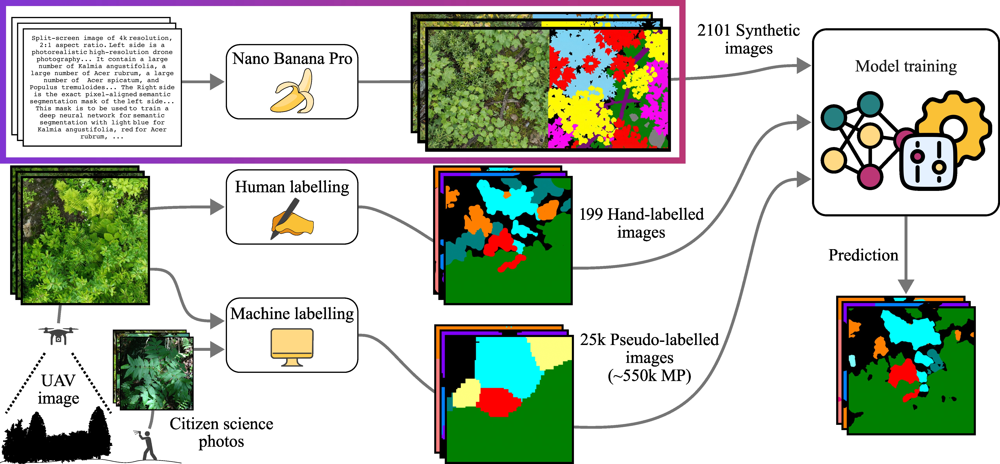

<div align="center">

<h1>Leveraging Image Generators to Address Training Data Scarcity:<br>The Gen4Regen Dataset for Forest Regeneration Mapping</h1>

**Gabriel&nbsp;Jeanson**<sup>1,2</sup>,
**David-Alexandre&nbsp;Duclos**<sup>1,2</sup>,
**William&nbsp;Larrivée-Hardy**<sup>1,2</sup>,
**Noé&nbsp;Cochet**<sup>1,2</sup>,
**Matěj&nbsp;Boxan**<sup>1,2</sup>,
**Anthony&nbsp;Deschênes**<sup>2</sup>,
**François&nbsp;Pomerleau**<sup>1,2</sup>,
**Philippe&nbsp;Giguère**<sup>1,2</sup>

<sup>1</sup>Northern&nbsp;Robotics&nbsp;Laboratory&nbsp;(Norlab), Université&nbsp;Laval<br>
<sup>2</sup>Département&nbsp;d'informatique&nbsp;et&nbsp;de&nbsp;génie&nbsp;logiciel, Université&nbsp;Laval

<a href="https://arxiv.org/abs/2605.05627"></a>
<a href="https://norlab-ulaval.github.io/gen4regen/"></a>




</div>

> [!NOTE]
> **Code and UAV images dataset will be available soon.**

## About

Mapping fine-grained species in forest regeneration zones from UAV imagery is held back by the scarcity of expert-annotated data and by extreme class imbalance. We use the image generator Nano Banana Pro to generate high-fidelity images **together with pixel-aligned semantic masks** directly from prompts, and create the **Gen4regen dataset**. We evaluate the impact of different data sources for semantic segmentation, and release:

- **WilDReF-Q-V2**: an extension of a natural forest dataset with 13 977 new unlabelled and 50 labelled real images.

Combining synthetic data with real-world pseudo-labels improves F1 score by over 13 %pt compared to purely supervised baselines, using Mask2Former, DINOv2, and DINOv3 models, with per-species gains of up to 30 %pt for underrepresented species.

## Citation

If you find this work useful, please cite:

```bibtex
@misc{jeanson2026_gen4regen,
    title = {Leveraging Image Generators to Address Training Data Scarcity: The Gen4Regen Dataset for Forest Regeneration Mapping},
    author = {Jeanson, Gabriel and Duclos, David-Alexandre and Larriv\'{e}e-Hardy, William and Cochet, No\'{e} and Boxan, Mat\v{e}j and Desch\^{e}nes, Anthony and Pomerleau, Fran\c{c}ois and Gigu\`{e}re, Philippe},
    year={2026},
    eprint={2605.05627},
    archivePrefix={arXiv},
    primaryClass={cs.CV},
    url={https://arxiv.org/abs/2605.05627},
}
```

## Contact

Northern Robotics Laboratory, Université Laval, Québec, QC, G1V 0A6, Canada  
gabriel.jeanson@norlab.ulaval.ca
